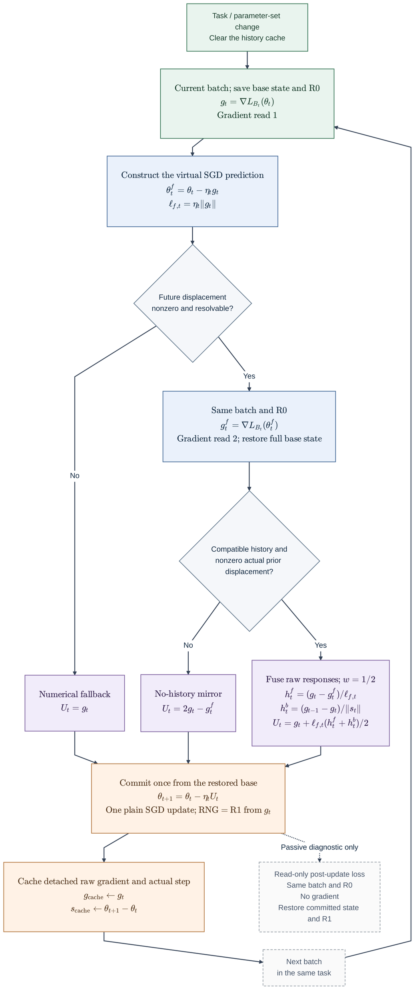

# 历史响应融合算法流程图

图中实线表示训练主流程，虚线表示不会改变训练轨迹的更新后损失诊断。正常可分辨步骤新增两次梯度计算；零或不可分辨预测直接回退到原始梯度。每次任务切换或参数集合变化清空历史，同任务跨批次保留缓存。未来探测使用同一个当前batch和R0；历史梯度直接复用上一batch的原始梯度，不重新计算，因此历史响应可能混有样本和随机实现变化。

图中 SGD 学习率沿用基线任务级日程，调度器仍每epoch前进一步；不在虚拟预测时调用优化器或调度器。算法没有固定的 GAM 内外半径，也没有QR、Hessian求逆、梯度分解或重定位扩展。
