# Pure Current-G2 for Llama-3.2-1B/3B, Order1

Only two **pure G2** presets are retained, with different AdamW backends. There are no new EWC/OLoRA experiments, strategy aliases or regularization hooks. No new LLM GPU training has been launched. Historical results/checkpoints and queues are unchanged.

## Actual algorithm

Let \(\theta\) be all currently trainable LoRA tensors and \(L_B\) the task cross-entropy averaged over a realized effective batch. Define \(N(v)=v/\|v\|_2\) above a numerical threshold, with the norm over the full trainable adapter scope.

\[
g_0=\nabla L_B(\theta),\qquad h=\eta\|g_0\|_2,
\]
\[
\theta_1=\theta-qN(g_0),\qquad g_1=\nabla L_B(\theta_1),
\]
\[
a=g_0-g_1,\qquad \theta_2=\theta+R N(a),\qquad g_2=\nabla L_B(\theta_2).
\]

Default `sgd_step` mode sets \(q=R=h\). The first point is computed literally as `theta - eta*g0`. Both probes use the same cached micro-batches and clean-pass dropout RNG states. The outer point starts from the **original** parameters. Restore the original parameters exactly, then submit **only g2**, clip once if configured, and call the named base optimizer once.

With AdamW, the probe remains a **virtual SGD prediction**, and the final update uses AdamW moments and weight decay. The final update is not `theta - eta*g2`, and the inner point is not an AdamW-predicted position. The same core also accepts ordinary momentum-free/weight-decay-free SGD for comparison against the original CV implementation; there is no SGD experiment preset in this plan.

`fixed_l2` sets an independent positive global parameter-space radius for either probe. Near-zero gradients/responses and FP32-indistinguishable points produce an explicit `g0_fallback` reason rather than an undefined normalized direction. There is no history, fourth gradient, Fisher, EWC, orthogonal correction, decomposition, Hessian-vector product, final direction normalization, model averaging or replay memory. AdamW weight decay in the Torch preset is the specified optimizer setting and is distinct from these removed method components.

```mermaid
flowchart LR
  A[BASE parameters and cached effective batch] --> B[g0 at BASE]
  B --> C[Descent probe: BASE minus q N g0]
  C --> D[g1; replay same dropout]
  D --> E[Restore BASE; a = g0 minus g1]
  E --> F[Outer probe: BASE plus R N a]
  F --> G[g2; replay same dropout]
  G --> H[Restore BASE exactly]
  H --> I[Clip g2 once; one AdamW commit]
```



```text
for each effective batch:
    cache micro-batches and clean-pass dropout RNG states
    g0 = globally averaged task CE gradient at BASE
    h = learning_rate * global_L2_norm(g0)
    q, R = independent configured radii or h
    g1 = globally averaged CE gradient at BASE - q*N(g0)
    g2 = globally averaged CE gradient at BASE + R*N(g0-g1)
    restore BASE exactly
    submit g2                       # explicit g0 fallback if degenerate
    clip once; base_optimizer.step() # exactly one actual commit
```

## Differences from this repository's SAM, GAM and GAM+EWC

Use separate notation below: \(s_1,s_2,s_3\) denote **GAM's** probe gradients and are not Current-G2's descending-probe gradients.

| Method | First probe | Relocation from BASE | Submitted gradient | CE gradients/update |
|---|---|---|---|---:|
| SAM | \(\theta+\rho N(g_0)\) | None | \(s_1\) | 2 |
| GAM | \(\theta+\rho N(g_0)\) | \(\theta+rN(s_1-g_0)\) | Corrected combination of \(s_1,s_3\) | 4 |
| GAM+EWC (reported FS-EWCLoRA) | Same as GAM | Same as GAM | GAM direction projected against each tensor's EWC gradient, then EWC added | 4 plus EWC computations |
| Pure Current-G2 | \(\theta-qN(g_0)\) | \(\theta+RN(g_0-g_1)\) | Only \(g_2\) | 3, fewer on explicit fallback |

GAM additionally evaluates \(s_2=\nabla L(\theta+rN(s_1-g_0))\) and \(s_3\) after a second positive inner probe from that relocated point. With beta1=beta2=beta3=1, its update is

\[
v=s_1+s_3-\gamma\left[(g_0+s_2)-\operatorname{proj}_{s_1+s_3}(g_0+s_2)\right].
\]

Historical NLP GAM scripts use inner0.02, outer0.2 and gamma0.03. SAM uses the configured `sam_rho` (default0.05). Current-G2 does not reuse either method's final combination or projection. The legacy GAM Trainer performs an additional clean forward for logging without backward before the four optimizer closure gradients; count gradients and wall time separately.

Execution also differs in two concrete ways. G2 replays each micro-batch's clean-pass dropout state; the legacy SAM/GAM replay helpers do not perform that per-microbatch RNG replay. G2 globally averages each phase before constructing the next probe, while legacy GAM encloses all four closures in DDP `no_sync` and averages the final composed direction. Thus legacy distributed GAM constructs rank-local probes. These are explicit implementation differences; shared model/data/batch/seed/update budgets do not make historical comparisons an intervention on the final gradient formula alone.

The historical `ewclora_gam` branch computes a clean-point EWC gradient \(e_p\) for each parameter tensor and applies

\[
u_p=v_p-\frac{\langle v_p,e_p\rangle}{\|e_p\|^2+\epsilon}e_p+e_p.
\]

This **per-tensor** EWC projection is separate from GAM's internal global orthogonal correction. The reported FS-EWCLoRA is not a simple `gGAM + gEWC` sum, and it is not the more recent `GAMFisherShape-SAM` class. Pure Current-G2 has neither correction nor task-Fisher computation. Its `inclora` branch retains the old adapter and trains a fresh low-rank branch; adapter concatenation when saving is the original IncLoRA mechanism, not a weighted model merge.

For small probes and identical stochastic realizations, \(s_1-g_0\approx\rho HN(g_0)\), whereas Current-G2's \(g_0-g_1\approx qHN(g_0)\). Thus reversing the first probe **and** reversing the gradient difference preserves the leading-order response direction. At finite radii the two responses can differ. This local Taylor interpretation is not a measured Hessian claim and does not make Current-G2 identical to SAM or GAM.

Sources: `src/optimer_sam.py`, `src/optimer_gam.py`, `src/uie_trainer_lora.py`, and the frozen historical source under `experiment_queue/nlp_multiseed_bf16_b64_ddp4_g0-3_20260922T150750Z/source/`.

## Shared experimental configuration

| Setting | Value |
|---|---|
| Models | Local Llama-3.2-1B and Llama-3.2-3B weights |
| Order1 | dbpedia → amazon → yahoo → agnews |
| Seeds | 0 initially; paired expansion 0,42,1993 |
| Adapter | Fresh rank8/task, alpha32, dropout0.1, Q/V |
| Saved adapter chain | Cumulative rank8 → 16 → 24 → 32 |
| Precision | BF16 forward; actual FP32 trainable LoRA coordinates |
| Effective batch | 64 = 4 DDP ranks × batch1 × accumulation16 |
| Learning rates | 0.001,0.0001,0.0001,0.0001 |
| Scheduler | Constant, warmup0 |
| Nominal epochs | 1/task, capped to the historical full-window budgets |
| Actual stage optimizer commits | 218,78,156,62; total514/Order |
| Adam betas / final clipping | 0.9,0.999 / global norm1 |
| Source / target / generation lengths | 512 / 50 / 50 |
| Evaluation batch | 4/device |
| Radius default | Both `sgd_step`, eta × norm(g0) |
| EWC/Fisher, OLoRA penalty, projection, model averaging | Disabled |

Explicit `max_steps` preserves historical full-window updates for train counts14000/5000/10000/4000, excluding incomplete final windows. Uncapped G2 calls handle short windows correctly but would add four updates across this Order, so that would be a different budget.

| Pure preset | Actual backend | epsilon | Weight decay | Historical backend reference |
|---|---|---:|---:|---|
| `inclora_g2` | `transformers.optimization.AdamW` | 1e-6 | 0 | IncLoRA / IncLoRA-SAM |
| `inclora_g2_gambase` | `torch.optim.AdamW` | 1e-8 | 0.01 | IncLoRA-GAM / reported FS-EWCLoRA |

The misleading historical `gam-adamw_hf` name wraps **Torch AdamW**; plain `adamw_hf` uses **Transformers AdamW**. These two pure presets make that distinction explicit. Their difference includes epsilon and weight decay, so it is not solely an implementation-library comparison.

Four manifests are provided: `configs/g2_llama/{inclora_g2,inclora_g2_gambase}_llama{1b,3b}_order1.json`. These JSON files are launcher manifests, not direct `run_uie_lora.py` argument JSONs.

## Reproducible commands

From `/data/140-1/users/liying/O-LoRA`, the following uses only Python's standard library, prints the plan, and creates no output directory or CUDA context:

```bash
python3 scripts_llama/run_g2_llama.py --config configs/g2_llama/inclora_g2_llama1b_order1.json --seed 0 --run-root /tmp/llama_g2_documented_dry_run --dry-run
```

Thin entry points:

```bash
bash scripts_order1_llama1B/IncLoRA-G2_LLaMA3-1b.sh --seed 0 --dry-run
bash scripts_order1_llama3B/IncLoRA-G2-GAMBase_LLaMA3-3b.sh --seed 0 --dry-run
```

The following is an execution example only and **was not run**. Replace the four physical GPU indices with the intended free cards and use a fresh output directory:

```bash
python3 scripts_llama/run_g2_llama.py --config configs/g2_llama/inclora_g2_gambase_llama1b_order1.json --seed 0 --gpus 2,3,4,5 --run-root experiment_queue/inclora_g2_gambase_llama1b_order1_s0
```

The launcher requires four explicitly selected idle GPUs, takes shared index/UUID locks, freezes source and input provenance, and runs a bounded two-task smoke before each formal four-stage chain. Existing output directories are refused. `--seeds 0 42 1993` extends the paired seed set.

Independent radii, without changing the learning rates:

```bash
python3 scripts_llama/run_g2_llama.py --config configs/g2_llama/inclora_g2_gambase_llama1b_order1.json --seed 0 --inner-radius-mode fixed_l2 --inner-radius 0.05 --outer-radius-mode fixed_l2 --outer-radius 0.05 --dry-run
```

## Plan, results and code boundaries

Start with the two backends × two model sizes, seed0: **four complete Orders/sixteen formal stages**. Expand to42/1993 only when the full chains and traces pass. The complete three-seed design is **twelve Orders/forty-eight formal stages**, plus bounded smoke stages. No new G2 LLM FAA is available yet.

Report historical FAA over the final four tasks (7600 examples/task,30400 total), each stage's task accuracies, paired per-seed changes, runtime, CE gradient counts, real optimizer commits, theoretical/actual probe radii, response norm, update norm, clipping and fallback count. Use sample standard deviation (`ddof=1`) for three seeds. Smoke/partial-Order accuracy is not final FAA.

Historical Order1 FAA references (three-seed mean ± sample standard deviation):

| Historical method | 1B FAA (%) | 3B FAA (%) |
|---|---:|---:|
| IncLoRA | 66.20 ± 0.56 | 67.35 ± 1.86 |
| EWCLoRA | 66.35 ± 0.84 | 68.59 ± 0.24 |
| FS-EWCLoRA (GAM + projected EWC) | 69.57 ± 0.27 | 72.57 ± 0.47 |

These are comparison references, not pure-G2 results. The 3B IncLoRA seed42 reference reused historical eight-card execution at the same global batch64. The source table and unrounded per-seed results remain under `experiment_queue/nlp_multiseed_bf16_b64_ddp4_g0-3_20260922T150750Z/history_reuse_20260926/`.

Implementation:

- `src/optimer_g2.py`: three-gradient transaction, exact BASE restoration, coupled/independent radii, fallback and one optimizer commit; no regularization interface.
- `src/uie_trainer_lora.py`: effective-window cache, per-microbatch RNG replay, mean DDP gradients, final clipping and `g2_step_trace.jsonl`.
- `src/run_uie_lora.py`: G2 CLI and FP32 trainable-adapter preparation.
- `scripts_llama/run_g2_llama.py`: manifest validation, four-stage adapter chain, frozen source, smoke gates and acceptance.

The warm NLP environment is `/data/140-1/users/liying/conda_envs/nlora_req/bin/python`, torch2.1.1+cu121, transformers4.28.0, datasets1.17.0, repository-local PEFT. No packages are installed. CPU tests and dry-run plans validate implementation/configuration; full BF16 GPU training and new FAA are still unmeasured.

Final offline validation: **20 core + 10 Trainer + 12 launcher tests passed**, plus **28 existing FisherShape/GAMFisherShape/SAM-EWC regression tests**. The Trainer checks include two CPU Gloo ranks and actual tiny random Llama training with both named AdamW backends, coupled radii and BF16 CPU forward; each backend completed two updates with three CE reads per update and no fallback. All72 expanded CLI argument sets parsed through the actual `HfArgumentParser`. The29 data/task/instruction files match the frozen historical inputs byte-for-byte. The G2 entry point also uses the existing rank-first datasets1.17 cache preparation, preventing parallel first-build cache renames. These checks do not replace the future full-model GPU smoke gate.

Audit artifacts: `refine-logs/llama-current-g2-order1-implementation-20261011T070131Z/`.
