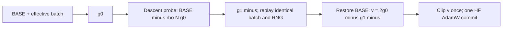

# Reflected descent probe in Llama NLP continual learning

Date: 2026-10-12. New method plus fresh matched controls under the corrected
`decoder_token_ids_v2` pipeline. Old G2, IncLoRA, SAM and FS-EWCLoRA result
tables are preserved and are not corrected-pipeline comparators.

## Algorithm

For the same realized effective batch B, use the complete globally averaged,
pre-clipping gradient over the current FP32 trainable adapter:

\[
g_0=\nabla L_B(\theta),\quad
g_1^-=\nabla L_B\left(\theta-0.05\frac{g_0}{\|g_0\|_2+10^{-12}}\right),\quad
v=2g_0-g_1^-.
\]

Restore the original parameters exactly, clip v once to global norm1,
then pass it to one ordinary Transformers AdamW step. This is a normalized
virtual SGD descent probe followed by an AdamW commit. It is **not** the
literal SGD update theta−eta*v, nor a virtual AdamW prediction. Probe radius
0.05 is independent of the training LR.

```text
for each effective batch:
    cache micro-batches and each clean-pass RNG state
    g0 = global_mean(task_CE_gradient_at_BASE)
    move trainable coordinates to BASE - .05*g0/(norm(g0)+1e-12)
    gminus = global_mean(task_CE_gradient_on_replayed_effective_batch)
    restore BASE parameters, forward state and post-clean RNG
    set gradient = 2*g0 - gminus
    clip gradient once to norm1
    HF_AdamW.step()                  # one real commit only
```

No g2/g3, relocation, history, Fisher/EWC, orthogonal projection, Hessian–
vector product, replay memory or weighted model averaging is computed.
The original IncLoRA saved-adapter concatenation remains, as in all controls.
Zero g0 or zero radius still causes the requested second CE read at BASE,
with explicit measured diagnostics and no silent fallback.



## Interpretation and controls

For small rho and a smooth deterministic loss, with u=g0/(norm(g0)+eps),
g1minus=g0−rho*H*u+O(rho²). Reflection gives
2g0−g1minus=g0+rho*H*u+O(rho²), as does the ascending SAM gradient to first
order. It does not reverse the curvature correction. Finite-radius terms,
BF16 kernels, clipping and AdamW moments can produce different real updates.
No experiment here estimates the full Hessian or establishes that the local
Taylor approximation holds throughout an NLP training trajectory.

| Method | Probe | Submitted gradient | Actual backend | CE phases/commit |
|---|---|---|---|---:|
| IncLoRA clean-gradient control | None | g0 | HF AdamW | 1 |
| SAM-direction control | BASE+rho*g0/(norm+eps) | g1plus | HF AdamW | 2 |
| Reflected descent probe | BASE−rho*g0/(norm+eps) | 2g0−g1minus | HF AdamW | 2 |

All three modes use the same new effective-window framework. This avoids
confounding the formula comparison with the legacy SAM's RNG replay and
reduction conventions. The clean-control internal mode is `sgd`, referring
only to g0 direction; the NLP commit backend is AdamW for **all** methods.

## Fixed protocol and first batch

- Models: local Llama-3.2-1B and Llama-3.2-3B.
- Order1: dbpedia→amazon→yahoo→agnews. First batch uses seed0.
- Fresh rank8/task, alpha32, dropout0.1, Q/V; saved ranks8/16/24/32.
- BF16 forward, FP32 trainable LoRA; DDP4 × batch1 × accumulation16 =64.
- HF AdamW epsilon1e-6, weight decay0, betas0.9/0.999, clip1.
- LR0.001 for first task,0.0001 afterwards; constant scheduler, warmup0.
- Source512, target/generation50, evaluation batch4/device.
- Task updates dbpedia218/amazon78/yahoo156/agnews62, total514/Order.
- Corrected decoder-v2 prompt/answer token IDs and complete target supervision.
- Physical GPU0/1/2/3 only; NCCL_P2P_DISABLE=1 is a recorded transport setting.

The first batch is **six complete Order1 chains = two models×three methods**,
24 formal stages, plus two bounded smoke stages per chain. Formal cost is
3,084 real AdamW commits,5,140 CE-gradient phases and2,056 replay phases.
The own-chain smoke gate trains two updates/task, checks rank8→16 and
frozen historical adapter prefixes, finite metrics and exact actual backend.
Before candidate formal admission, its first smoke-stage initial trainables,
realized effective-window tensors and clean g0 hashes must equal the same
model's clean-control hashes.

Eighteen source JSON profiles and matching inspection wrappers cover all
three Orders and both models/modes; seeds0/42/1993 are available in the
catalog. **Only the six Order1/seed0 chains enter this queue.** Other Orders
and seeds are a future confirmation plan, not automatically scheduled.

## Evidence to collect

Primary: final four-task equal FAA, four-stage seen-task equal AAA, BWT on
the first three tasks, per-task learning accuracy, and paired deltas vs fresh
clean and SAM controls. Normalize exact match exactly as the historical
metric implementation, using all7,600 test samples per seen task and pinned
gold labels. Smoke and incomplete chains have no final FAA/AAA/BWT.

Mechanism/cost: cos(g0,g1), cos(g0,v), ||v−g0||/||g0||,
||g0−g1||/||g0||, gradient norms before/after clipping, clipping scale,
actual/theoretical radius, real update/radius, optimizer groups, actual CE
and replay counts, runtime and paired first-window hashes. The sampled
BF16 weight-cast proxy does not prove actual forward visibility.

A reverse-over-clean gain is evidence about this configuration. Comparison
with SAM tests the finite-radius reflection, not whether the first-order
SAM correction has been removed. Single-seed Order1 results are preliminary;
confirm with seeds0/42/1993 and additional Orders before a general claim.
Training trajectory diagnostics cannot be interpreted as a same-point
reverse/SAM comparison once the methods' parameters have diverged.

## Implementation and execution

- Core: `src/optimer_reverse_probe.py`, class `TwoPointProbe`.
- Trainer: `src/uie_trainer_lora.py`, `_run_two_point_probe_optimizer_window`
  and `finish_two_point_probe_training_audit`.
- Entry flags: optimizer_type=probe-adamw_hf; probe_mode=reverse/sam/sgd;
  probe_rho=.05; probe_eps=1e-12; probe_quantization_diagnostics_interval=20.
- Configurations: `configs/two_point_probe_llama/*.json`.
- Inspection: `scripts_llama/run_two_point_probe_llama.py`.
- Frozen queue: `scripts_llama/run_two_point_probe_queue.py`.
- Result collector: `scripts_llama/collect_two_point_probe_results.py`.
- Traces: `probe_step_trace.jsonl`; final audit:
  `two_point_probe_training_audit.json`.

Exact dry-run and prepare/run commands, warm environment identity and current
queue paths are in `ENVIRONMENT.md`. The queue reserves all four GPUs only
after idle checks and shared index/UUID locks; fresh per-card CUDA/BF16
witnesses and native smoke gates precede formal admission. It preserves
failed/interrupted output directories and stops on unexpected failures.
