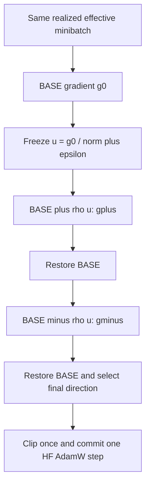

# Llama NLP: matched three-read signed-probe comparison

## Question and exact directions

Does a centered combination preserve the learning and retention effects of
the ascending SAM direction and reflected descending direction when all
methods observe the same three points? This is a comparison of raw submitted
gradients; the final optimizer is Transformers AdamW in all four groups.

At each effective minibatch, compute

\[
g_0=\nabla L_B(\theta),\quad u=\frac{g_0}{\|g_0\|_2+10^{-12}},\quad
g_+=\nabla L_B(\theta+0.05u),\quad
g_-=\nabla L_B(\theta-0.05u).
\]

Both probe points are constructed independently from BASE using the same
pre-clipping, globally averaged clean gradient. Replay the same realized
microbatches and their individual dropout RNG states on both sides.

| Method | `probe_mode` | Raw gradient submitted after BASE restoration | CE gradient phases / real optimizer commits |
|---|---|---|---|
| Ascending SAM direction | `g1_plus` | \(g_+\) | 3 / 1 |
| Reflected descent direction | `backward_reflected` | \(2g_0-g_-\) | 3 / 1 |
| Centered response direction | `central` | \(g_0+\tfrac12(g_+-g_-)\) | 3 / 1 |
| Clean-gradient control | `g0` | \(g_0\) | 3 / 1 |

All four groups compute both probes, including the clean-gradient group.
Zero radius or zero clean gradient still executes all three reads. Restore
BASE before clipping the selected gradient once at norm1 and committing one
AdamW step. Probe computations do not modify AdamW moments, perform virtual
AdamW updates, or advance the scheduler. There is no outer G2/G3 probe,
Fisher/EWC, history, weight fusion, projection, or HVP computation.

The probe is a normalized virtual SGD displacement with fixed radius0.05,
independent of the AdamW learning rate. The final parameter displacement is
the actual AdamW step; it is not the literal SGD update theta−eta*v.

## Pseudocode

```text
for realized effective minibatch B:
    BASE = snapshot(trainable parameters and supported forward state)
    g0 = global_mean(task_CE_gradient(BASE, B))
    u = g0 / (global_L2_norm(g0) + 1e-12)
    restore BASE; gplus  = replay_global_mean_CE_gradient(BASE + .05*u, B)
    restore BASE; gminus = replay_global_mean_CE_gradient(BASE - .05*u, B)
    restore BASE
    v = select(g0, gplus, gminus, probe_mode)
    parameter.grad = v
    clip_global_grad_norm_once(1)
    HF_AdamW.step()                  # one actual commit
    scheduler.step()                 # one advance
    zero_grad()
```



## What the central group tests

At one parameter point, its raw submitted gradient is exactly

\[
v_{central}=\tfrac12\left[g_++(2g_0-g_-)\right].
\]

It averages the two one-sided submitted gradients before AdamW. Averaging
two separately trained models or two actual AdamW updates is a different
operation. Training trajectories will diverge after the first update.

For a smooth deterministic loss and frozen u at BASE,

\[
g_\pm=g_0\pm\rho Hu+\tfrac{\rho^2}{2}\nabla^3L[u,u]
+O(\rho^3),
\quad v_{central}=g_0+\rho Hu+O(\rho^3).
\]

SAM and reflected descent share the same first-order term but have opposite
second-order terms. Centering cancels the even component in this local
expansion. This motivates the comparison; BF16 forward, finite radius,
clipping, nonsmooth behavior and AdamW can change its practical effect.
The submitted central response is **not divided by rho**. Dividing
\((g_+-g_-)\) by \(2\rho\) would estimate an HVP instead of implementing
the requested update. No claim of improved accuracy follows from this
algebra alone.

## Fixed configuration and queue scope

- Models: local Llama-3.2-1B and Llama-3.2-3B.
- Initial cohort: Order1=dbpedia→amazon→yahoo→agnews, seed0.
- IncLoRA: fresh rank8 per task, alpha32, dropout0.1, Q/V adapters;
  accumulated adapter ranks8/16/24/32, historical slices frozen.
- BF16 forward, FP32 trainable LoRA parameters; DDP4, per-device batch1,
  accumulation16, effective batch64.
- Transformers AdamW: betas0.9/0.999, epsilon1e-6, weight decay0,
  max grad norm1; first-task LR0.001, later-task LR0.0001,
  constant scheduler, warmup0.
- Source length512, target and generation length50, eval batch4/device.
- Formal updates per task218/78/156/62, total514 per Order.
- Corrected `decoder_token_ids_v2`: separately tokenized prompt and target,
  direct ID concatenation and complete causal target supervision.
- Probe radius0.05, normalization epsilon1e-12; all four modes use3 CE
  phases and2 replay phases per real update, including `g0`.
- Physical GPUs0–3 only; idle admission and shared UUID/index locks.
  NCCL_P2P_DISABLE=1 uses the existing tested transport remedy.

The active cohort has **8 complete Orders,32 formal stages,16 own-chain
smoke stages**, with4,112 formal optimizer commits,12,336 CE gradient
phases and8,224 replay phases. Each own-chain two-stage native smoke
(2 updates/task, rank8→16) must pass before formal training. Candidate
first-step BASE parameters, clean gradient and effective batch hashes must
match the same model's fresh `g0` smoke control.

The previous two-point campaign remains a separate cohort and continues
using its frozen source. The new controller waits until physical GPUs0–3
are free; it does not edit or preempt the earlier queue. Earlier clean,
SAM and reflected results have different read budgets and are not entered
as this cohort's matched three-read controls. Historical label-boundary-bug
results are not used as fresh baselines. Order2/3 and seeds42/1993 are
configuration catalog entries only, not automatically admitted in this
initial cohort.

## Metrics and acceptance

- Report final FAA, four-stage equally weighted AAA and BWT in percent;
  retain the full lower-triangular stage/task evaluation matrix.
- Paired deltas: central vs clean, ascending and reflected directions.
  Separate immediately-after-learning accuracy from subsequent retention.
- Record actual radius on each side, global raw gradient norms,
  cos(g0,v), relative submitted change, actual AdamW update norm,
  clipping ratio and finite losses.
- Record symmetric response \((g_+-g_-)/2\), even response
  \((g_++g_--2g_0)/2\), and agreement between ascending response
  \(g_+-g_0\) and reflected response \(g_0-g_-\).
- Verify3 reads/2 replays/1 real optimizer commit on every update,
  exact BASE restoration, no fallback and no disabled-module activity.
- Quantized parameter-cast diagnostics are observational proxies, not proof
  that the full BF16 forward sees a perturbation identically to FP32.
- Report wall-clock and CE-phase cost; do not use smoke scores as formal
  results. Single-seed Order1 is preliminary, not a significance test or
  a general NLP superiority claim.

Implementation: `src/optimer_three_point_probe.py`, native trainer and
`run_uie_lora.py` integration. Configurations:
`configs/three_point_probe_llama/`. Exact inspection/preparation/controller
invocations and the fixed campaign paths are in `ENVIRONMENT.md`.
