# Pure Current-G2 for Llama-3.2 — current code and archived results

The HF AdamW seed0 experiment for both model sizes and all three Orders
completed on 2026-10-12 (6 Orders / 24 formal stages). Its old frozen decoder
pipeline has subsequently been found defective; archived scores and source
are preserved, but a corrected comparison needs fresh IncLoRA and G2 runs.

Current source uses `decoder_token_ids_v2`, with separate prompt/answer token
IDs, correct causal answer supervision, and G2 gradient/radius diagnostics.
Twelve independent-radius HF AdamW candidate profiles and wrappers are ready,
with q0.05 and R0.05/0.2, seeds0/42/1993. No corrected formal training has
been launched. Old unversioned profiles are inspection-only in the live
launcher; historical frozen runners are unchanged.

See [the current configuration and usage guide](G2_LLAMA_CORRECTED_V2.md),
[the implementation and phased plan](../refine-logs/llama_g2_token_boundary_fix_20261012/IMPLEMENTATION_AND_PLAN.md),
and [the archived-result qualification](../refine-logs/llama_pure_g2_hf_results_20261012T084626Z/LABEL_BOUNDARY_ADDENDUM_20261012.md).

## Actual algorithm

Let \(\theta\) be all currently trainable LoRA tensors and \(L_B\) the task cross-entropy averaged over a realized effective batch. Define \(N(v)=v/\|v\|_2\) above a numerical threshold, with the norm over the full trainable adapter scope.

\[
g_0=\nabla L_B(\theta),\qquad h=\eta\|g_0\|_2,
\]
\[
\theta_1=\theta-qN(g_0),\qquad g_1=\nabla L_B(\theta_1),
\]
\[
a=g_0-g_1,\qquad \theta_2=\theta+R N(a),\qquad g_2=\nabla L_B(\theta_2).
\]

Default `sgd_step` mode sets \(q=R=h\). The first point is computed literally as `theta - eta*g0`. Both probes use the same cached micro-batches and clean-pass dropout RNG states. The outer point starts from the **original** parameters. Restore the original parameters exactly, then submit **only g2**, clip once if configured, and call the named base optimizer once.

With AdamW, the probe remains a **virtual SGD prediction**, and the final update uses AdamW moments and weight decay. The final update is not `theta - eta*g2`, and the inner point is not an AdamW-predicted position. The same core also accepts ordinary momentum-free/weight-decay-free SGD for comparison against the original CV implementation; there is no SGD experiment preset in this plan.

`fixed_l2` sets an independent positive global parameter-space radius for either probe. Near-zero gradients/responses and FP32-indistinguishable points produce an explicit `g0_fallback` reason rather than an undefined normalized direction. There is no history, fourth gradient, Fisher, EWC, orthogonal correction, decomposition, Hessian-vector product, final direction normalization, model averaging or replay memory. AdamW weight decay in the Torch preset is the specified optimizer setting and is distinct from these removed method components.

```mermaid
flowchart LR
  A[BASE parameters and cached effective batch] --> B[g0 at BASE]
  B --> C[Descent probe: BASE minus q N g0]
  C --> D[g1; replay same dropout]
  D --> E[Restore BASE; a = g0 minus g1]
  E --> F[Outer probe: BASE plus R N a]
  F --> G[g2; replay same dropout]
  G --> H[Restore BASE exactly]
  H --> I[Clip g2 once; one AdamW commit]
```



```text
for each effective batch:
    cache micro-batches and clean-pass dropout RNG states
    g0 = globally averaged task CE gradient at BASE
    h = learning_rate * global_L2_norm(g0)
    q, R = independent configured radii or h
    g1 = globally averaged CE gradient at BASE - q*N(g0)
    g2 = globally averaged CE gradient at BASE + R*N(g0-g1)
    restore BASE exactly
    submit g2                       # explicit g0 fallback if degenerate
    clip once; base_optimizer.step() # exactly one actual commit
```

## Differences from this repository's SAM, GAM and GAM+EWC

Use separate notation below: \(s_1,s_2,s_3\) denote **GAM's** probe gradients and are not Current-G2's descending-probe gradients.

| Method | First probe | Relocation from BASE | Submitted gradient | CE gradients/update |
|---|---|---|---|---:|
| SAM | \(\theta+\rho N(g_0)\) | None | \(s_1\) | 2 |
| GAM | \(\theta+\rho N(g_0)\) | \(\theta+rN(s_1-g_0)\) | Corrected combination of \(s_1,s_3\) | 4 |
| GAM+EWC (reported FS-EWCLoRA) | Same as GAM | Same as GAM | GAM direction projected against each tensor's EWC gradient, then EWC added | 4 plus EWC computations |
| Pure Current-G2 | \(\theta-qN(g_0)\) | \(\theta+RN(g_0-g_1)\) | Only \(g_2\) | 3, fewer on explicit fallback |

GAM additionally evaluates \(s_2=\nabla L(\theta+rN(s_1-g_0))\) and \(s_3\) after a second positive inner probe from that relocated point. With beta1=beta2=beta3=1, its update is

\[
v=s_1+s_3-\gamma\left[(g_0+s_2)-\operatorname{proj}_{s_1+s_3}(g_0+s_2)\right].
\]

Historical NLP GAM scripts use inner0.02, outer0.2 and gamma0.03. SAM uses the configured `sam_rho` (default0.05). Current-G2 does not reuse either method's final combination or projection. The legacy GAM Trainer performs an additional clean forward for logging without backward before the four optimizer closure gradients; count gradients and wall time separately.

Execution also differs in two concrete ways. G2 replays each micro-batch's clean-pass dropout state; the legacy SAM/GAM replay helpers do not perform that per-microbatch RNG replay. G2 globally averages each phase before constructing the next probe, while legacy GAM encloses all four closures in DDP `no_sync` and averages the final composed direction. Thus legacy distributed GAM constructs rank-local probes. These are explicit implementation differences; shared model/data/batch/seed/update budgets do not make historical comparisons an intervention on the final gradient formula alone.

The historical `ewclora_gam` branch computes a clean-point EWC gradient \(e_p\) for each parameter tensor and applies

\[
u_p=v_p-\frac{\langle v_p,e_p\rangle}{\|e_p\|^2+\epsilon}e_p+e_p.
\]

This **per-tensor** EWC projection is separate from GAM's internal global orthogonal correction. The reported FS-EWCLoRA is not a simple `gGAM + gEWC` sum, and it is not the more recent `GAMFisherShape-SAM` class. Pure Current-G2 has neither correction nor task-Fisher computation. Its `inclora` branch retains the old adapter and trains a fresh low-rank branch; adapter concatenation when saving is the original IncLoRA mechanism, not a weighted model merge.

For small probes and identical stochastic realizations, \(s_1-g_0\approx\rho HN(g_0)\), whereas Current-G2's \(g_0-g_1\approx qHN(g_0)\). Thus reversing the first probe **and** reversing the gradient difference preserves the leading-order response direction. At finite radii the two responses can differ. This local Taylor interpretation is not a measured Hessian claim and does not make Current-G2 identical to SAM or GAM.

Sources: `src/optimer_sam.py`, `src/optimer_gam.py`, `src/uie_trainer_lora.py`, and the frozen historical source under `experiment_queue/nlp_multiseed_bf16_b64_ddp4_g0-3_20260922T150750Z/source/`.

## Configuration and checks

The corrected shared settings are rank8/task, alpha32, dropout0.1, Q/V;
FP32 trainable LoRA / BF16 forward; DDP4 and effective batch64; HF AdamW,
epsilon1e-6, weight decay0, clip1; constant first-stage LR0.001, later0.0001;
source512, target/generation50, and514 capped updates per Order.

Use `configs/g2_llama/corrected_v2/` and the TokV2 wrappers, with a fresh
output directory. The live collector cannot silently reuse historical v1
baselines. The fixed radii are candidates, not validated best values.

The warm environment remains
`/data/140-1/users/liying/conda_envs/nlora_req/bin/python`; no packages changed.
CPU tests include actual local tokenizers, tiny Llama loss/backward,
BF16/FP32-LoRA G2 with HF/Torch AdamW, and two-rank CPU Gloo. Twelve literal
wrapper dry-runs pass without CUDA or training output creation. Separate
precision diagnostics and BF16 cast proxies do not establish actual full-model
probe visibility or new accuracy results.

The superseded initial Order1-only document is preserved as
`refine-logs/llama_g2_token_boundary_fix_20261012/LEGACY_G2_LLAMA_ORDER1_PRE_FIX.md`.
Use it only as historical context: its launch commands and unmeasured-status
statements no longer describe the live source.
