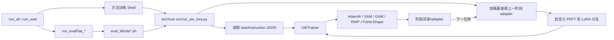

# O-LoRA 连续学习实现与实验 Wiki

> 本文基于 2026-08-11 当前工作区的实际文件整理，记录的是“当前代码状态”，而不是文件名或注释所表达的理想状态。第 1–12 节保留 Order1 入口、配置和调用链盘点；第 13–15 节从实现角度总结 LoRA/ORA 策略 × 优化器，并单独说明 EWCLoRA、EWCLoRA-GAM、FisherShape-EWCLoRA 与 Phase-1 GAMFisherShape-SAM。当前工作区含未提交实现，涉及版本差异时会明确区分提交版与工作树版本。

## 1. 一页结论

- 四类实验最终都走同一主链：Shell runner → 方法 Shell → `torchrun src/run_uie_lora.py` → `UIETrainer` → 自定义 PEFT LoRA。
- Order1 的任务顺序固定为 `dbpedia → amazon → yahoo → agnews`；每一阶段从上一阶段的 `adapter` 继续训练。
- 自定义 LoRA 层包含两支：历史累计参数 `lora_A/B` 和当前任务参数 `loranew_A/B`。IncLoRA、OLoRA、EWCLoRA 只训练 new；SeqLoRA 反过来只训练 old。
- `lora_strategy` 与 `optimizer_type` 是两个独立维度：前者选择可训练分支和正则项，后者选择梯度的计算、扰动与组合方式。
- 当前工作树中的普通 EWCLoRA 已不是最初提交的纯 `CE + EWC`：它还会默认加入 OLoRA 正交项；跨版本比较时必须记录这一点。
- `run_all_seqlora.sh` 是最完整的 T5 Order1 编排：Base、SAM、GAM、RWP 四组训练和 learned-only 评估。
- `run_all_ewc.sh` 串行覆盖 Order1/2/3 的 EWC 与 EWC-GAM，共 6 个方法脚本、24 次阶段训练。
- 当前 [`run_all_inc-olora.sh`](scripts_order1/run_all_inc-olora.sh) 全部被注释，是成功退出但不做任何工作的 no-op。
- 两个名为 `run_wait_*` 的脚本当前都不会等待 GPU，因为检测与轮询块已经被注释。
- 当前工作区位于 `/data/140-1/...`，但大量模型、输出、评估脚本和 `torchrun` 路径硬编码为 `/data/140-0/...`；本次检查时这些 `/data/140-0` 目标并不存在，不能直接在当前节点运行。

## 2. 目录定位

| 目录 | 实际基座 | 方法覆盖 | 与 7 个重点入口的关系 |
|---|---|---|---|
| `scripts_order1` | 主要为 T5-large | Base / SAM / GAM / RWP / EWC，含 RWP std sweep | 7 个重点入口都在这里 |
| `scripts_order1_llama1B` | Llama-3.2-1B | Inc/OLoRA/Seq 的 Base/SAM/GAM/RWP，加 EWC/EWC-GAM | 平行的 1B 实验族，不被 7 个入口调用 |
| `scripts_order1_llama3B` | Llama-3.2-3B | 与 1B 基本同构 | 平行的 3B 实验族，不被 7 个入口调用 |
| `scripts_order1_llama7B` | Llama-2-7b-hf | Inc/OLoRA/Seq 的 Base/SAM；无 GAM/RWP/EWC | 平行的 7B 实验族，不被 7 个入口调用 |

注意：1B/3B 文件名仍写成 `LLaMA2-1b` / `LLaMA2-3b`，真实的 [`--model_name_or_path`](scripts_order1_llama1B/SeqLoRA_LLaMA2-1b.sh#L22) 指向 Llama 3.2；只有 7B 目录实际使用 Llama 2。

## 3. 总体调用链



核心代码路径：

1. [`main()` 与参数解析](src/run_uie_lora.py#L652)：`HfArgumentParser(ModelArguments, DataTrainingArguments, UIETrainingArguments)`。
2. [`load_dataset`](src/run_uie_lora.py#L768)：调用 [`src/uie_dataset_lora.py`](src/uie_dataset_lora.py)，读取任务与 instruction 配置。
3. [`_load_model_config_and_tokenizer`](src/run_uie_lora.py#L596)：识别基座或 adapter，并区分 T5 / Llama。
4. [`LoRA 策略参数冻结`](src/run_uie_lora.py#L1111)：决定训练 `lora_*` 还是 `loranew_*`。
5. [`UIETrainer` 构造](src/run_uie_lora.py#L1435)并进入自定义训练循环。
6. 即使 Shell 设置 `--save_strategy no`，训练结束仍会显式写入 [`<output_dir>/adapter`](src/run_uie_lora.py#L1482)。

所有相对路径（`src/...`、`configs/...`、`CL_Benchmark`）都要求从仓库根目录启动。

## 4. 数据配置与阶段链

### 4.1 三种任务顺序

| Order | 连续学习顺序 | 配置目录 |
|---|---|---|
| Order1 | dbpedia → amazon → yahoo → agnews | `configs/order1_configs` |
| Order2 | dbpedia → amazon → agnews → yahoo | `configs/order2_configs` |
| Order3 | yahoo → amazon → agnews → dbpedia | `configs/order3_configs` |

每个任务目录包含 `train_tasks.json`、`dev_tasks.json`、`test_tasks.json`。解析发生在 [`UIEConfig._parse_task_config`](src/uie_dataset_lora.py#L168)，split 由 [`_split_generators`](src/uie_dataset_lora.py#L233)建立。

### 4.2 Order1 的训练与累计测试

| 阶段 | `task_config_dir` | 当前训练集 | `test_tasks.json` 中的累计测试集 |
|---:|---|---|---|
| 1 | `configs/order1_configs/dbpedia` | dbpedia | dbpedia |
| 2 | `configs/order1_configs/amazon` | amazon | dbpedia、amazon |
| 3 | `configs/order1_configs/yahoo` | yahoo | dbpedia、amazon、yahoo |
| 4 | `configs/order1_configs/agnews` | agnews | dbpedia、amazon、yahoo、agnews |

模型链始终是：

```text
基座模型
  → <run_root>/1-dbpedia/adapter
  → <run_root>/2-amazon/adapter
  → <run_root>/3-yahoo/adapter
  → <run_root>/4-agnews/adapter
```

训练配置使用 `configs/instruction_config.json`、`instruction_strategy=single`，并设置 `add_task_name=True`、`add_dataset_name=True`。collator 会把任务名和数据集名加入输入，见 [`src/uie_collator.py`](src/uie_collator.py#L136)。

### 4.3 learned-only 外部评估

外部评估不直接复用累计 `test_tasks.json`，而是使用拼写为 `lineraProbe` 的单任务配置：

```text
configs/lineraProbe_order1_configs/<task>
```

评估 runner 显式生成三角矩阵：stage 1 测 1 项、stage 2 测 2 项、stage 3 测 3 项、stage 4 测 4 项。因此每个模型根目录有 `1+2+3+4=10` 个单 GPU 评估任务。调用链为：

```text
run_evalFlat_*.sh
  → Olora_Eval1/eval_Whole.sh 或 eval_Whole_olora.sh
  → torchrun --nproc_per_node=1 src/run_uie_lora.py --do_predict
  → <model_root>/<stage>/evalFlat-<task>-trainedLoRAwhole
```

虽然目录名含 `evalFlat`，并传了 `flat_part=trained_whole`，但 [`eval_Whole.sh`](scripts_order1/Olora_Eval1/eval_Whole.sh#L21) 没有设置 `do_flatminal`，而 loss-landscape 主分支当前也是 [`if False`](src/run_uie_lora.py#L1597)。所以这里实际是生成式预测评估，不是 flat-minima / loss-landscape 分析。

## 5. 七个重点入口

### 5.1 `scripts_order1/run_all_ewc.sh`

调用：

```bash
bash scripts_order1/run_all_ewc.sh [seed=1993] [gpu_ids=0,1,2,3,4,5,6,7] [lambda_ewc=1.0] [gamma_ewc=1.0]
```

入口先激活 `nlora_req`，然后按以下顺序严格串行执行：

```text
Order1 EWCLoRA
→ Order1 EWCLoRA-GAM
→ Order2 EWCLoRA
→ Order2 EWCLoRA-GAM
→ Order3 EWCLoRA
→ Order3 EWCLoRA-GAM
```

脚本数组和参数转发见 [`run_all_ewc.sh`](scripts_order1/run_all_ewc.sh#L12)。子脚本接收顺序是 `gpu_ids seed lambda gamma`。每个子脚本包含 4 个阶段，因此总计 24 次 `torchrun`；任一命令失败会停止后续任务。

| 变体 | `lora_strategy` | `optimizer_type` | 额外参数 |
|---|---|---|---|
| EWCLoRA | `ewclora` | `adamw_hf` | `ewclora_lambda`、`ewclora_gamma` |
| EWCLoRA-GAM | `ewclora_gam` | `gam-adamw_hf` | EWC 参数 + GAM 参数组 |

两个 EWC 叶子脚本都同时设置 `--do_train --do_predict`，所以每阶段训练后还会按该阶段累计 `test_tasks.json` 做预测。Order1 参考 [`EWCLoRA_E1_Le3.sh`](scripts_order1/EWCLoRA_E1_Le3.sh#L25)与 [`EWCLoRA-GAM_E1_Le3.sh`](scripts_order1/EWCLoRA-GAM_E1_Le3.sh#L25)。

### 5.2 `scripts_order1/run_all_inc-olora.sh`

当前文件从 shebang 到所有命令都被注释，运行它会立即成功退出，但不会训练、评估或产生日志。

注释保留的设计意图是：

```text
Phase 1: IncLoRA-SAM(GPU 0-3) || OLoRA-SAM(GPU 4-7)
Phase 2: IncLoRA-Base(GPU 0-3) || OLoRA-Base(GPU 4-7)
Phase 3: Inc/OLoRA 两组 learned-only 评估
```

这会直接影响 `run_wait_inclora-olora_all_order.sh`：它调用 Order1 runner 后会错误地把 no-op 记录成“Order1 全部完成”。

### 5.3 `scripts_order1/run_all_seqlora_rwp_std_sweep.sh`

调用：

```bash
bash scripts_order1/run_all_seqlora_rwp_std_sweep.sh [seed=1993]
```

| Phase | GPU 0-3 | GPU 4-7 | 同步点 |
|---|---|---|---|
| 1：训练 | RWP std=0.005 | RWP std=0.01 | 两项完成后继续 |
| 2：评估 | std=0.005 learned-only | std=0.01 learned-only | 两项完成后退出 |

共 8 次阶段训练和 20 个单 GPU 评估任务。两组仅 `noise_std`、GPU 和输出目录不同，其余都是：

```text
lora_strategy=seqlora
optimizer_type=adamw_hf
rwp_type=lora
rwp_a=0
rwp_b=1
rwp_noise_type=Gauss_standard
```

详见 [`std0p005`](scripts_order1/SeqLoRA_RWPlora-Gaussian_std0p005.sh#L22)与 [`std0p01`](scripts_order1/SeqLoRA_RWPlora-Gaussian_std0p01.sh#L22)。

### 5.4 `scripts_order1/run_all_seqlora_gam_rwp.sh`

调用：

```bash
bash scripts_order1/run_all_seqlora_gam_rwp.sh [seed=1993]
```

```text
Phase 1:
  SeqLoRA-GAM, GPU 0-3
  SeqLoRA-RWP std=0.02, GPU 4-7

Phase 2:
  GAM learned-only eval, GPU 0-3
  RWP learned-only eval, GPU 4-7
```

共 8 次阶段训练和 20 个单 GPU 评估任务。RWP 叶子文件名是 [`SeqLoRA_E5_Le3_RWPlora-Gaussian.sh`](scripts_order1/SeqLoRA_E5_Le3_RWPlora-Gaussian.sh)，但实际 `num_train_epochs=1`，输出名也写 E1；`E5` 不能作为真实 epoch 数理解。

### 5.5 `scripts_order1/run_all_seqlora.sh`

调用：

```bash
bash scripts_order1/run_all_seqlora.sh [seed=1993]
```

| Phase | GPU 0-3 | GPU 4-7 |
|---|---|---|
| 1 | GAM | SAM |
| 2 | Base / AdamW | RWP std=0.02 |
| 3 | SAM + GAM 的评估 runner | Base + RWP 的评估 runner |

训练 Phase 之间串行，同一 Phase 的两项并行；总计 4 方法 × 4 阶段 = 16 次训练，4 个模型根目录 × 10 = 40 个单 GPU 评估任务。

| 方法 | `lora_strategy` | `optimizer_type` | 方法参数 |
|---|---|---|---|
| Base | `seqlora` | `adamw_hf` | 无 |
| SAM | `seqlora` | `sam-adamw_hf` | `sam_rho=0.05` |
| GAM | `seqlora` | `gam-adamw_hf` | rho/norm-rho/beta/gamma 参数组 |
| RWP | `seqlora` | `adamw_hf` | `rwp_type=lora, a=0, b=1, std=0.02` |

三个 SeqLoRA runner 都使用 `wait_for_batch`：若并行任务之一失败，会 kill 同批记录的其他 PID 并返回失败，见 [`run_all_seqlora.sh`](scripts_order1/run_all_seqlora.sh#L6)。

### 5.6 `scripts_order1/run_wait_inclora-olora_all_order.sh`

调用：

```bash
bash scripts_order1/run_wait_inclora-olora_all_order.sh [seed=1993]
```

当前实际顺序：

```text
Order1 run_all_inc-olora.sh   # 当前 no-op
→ Order2 run_all_inc-olora.sh # 活跃
→ Order3 run_all_inc-olora.sh # 活跃
```

GPU 空闲函数与“每小时轮询”块分别在 [`17-27`](scripts_order1/run_wait_inclora-olora_all_order.sh#L17)和 [`42-51`](scripts_order1/run_wait_inclora-olora_all_order.sh#L42)被注释，因此脚本会立即开始。Order2/3 runner 仍依次运行 SAM 组、Base 组和评估组。

主日志写入：

```text
Logs_RedoOlora/run_logs/inclora_olora_sam_sgd_seed-<seed>_<timestamp>.log
```

它只记录顶层状态，子训练命令没有重定向到 master log。

### 5.7 `scripts_order1/run_wait_seqlora_all_orders.sh`

调用：

```bash
bash scripts_order1/run_wait_seqlora_all_orders.sh
```

该入口没有 seed 参数，所有子脚本依赖默认 seed 1993。GPU 等待逻辑同样被注释。当前矩阵是：

| Order | 训练 | 评估 | 当前问题 |
|---|---|---|---|
| 1 | 只启动 SAM；Base 行被注释 | SAM 与 Base 都评估 | Base 可能读取旧结果或因模型不存在而失败 |
| 2 | SAM + Base 并行 | 两者并行 | 活跃 |
| 3 | SAM + Base 并行 | 两者并行 | 活跃 |

Order1 的不一致见 [`63-70`](scripts_order1/run_wait_seqlora_all_orders.sh#L63)。主日志位于 `Logs_RedoOlora/run_logs/seqlora_sam_sgd_<timestamp>.log`，同样不包含完整子进程输出。

## 6. T5 叶子训练配置矩阵

共同值：LoRA rank 8、bf16、`max_source_length=512`、`max_target_length=50`、constant scheduler、warmup 0、1 epoch、无中途 evaluation/checkpoint save；训练结束由 Python 显式保存 adapter。

| 叶子脚本 | 策略 | 优化/扰动 | batch 配置 | 初始模型 / 备注 |
|---|---|---|---|---|
| `EWCLoRA_E1_Le3.sh` | `ewclora` | AdamW | device 8 × 默认 8 GPU × GA1 = 64 | T5-large；lr=1e-3 |
| `EWCLoRA-GAM_E1_Le3.sh` | `ewclora_gam` | GAM-AdamW | 同上 | T5-large；lr=1e-3 |
| `IncLoRA-SAM_E1_Le3.sh` | `Inclora` | SAM-AdamW, rho=.05 | device 16 × 4 GPU × GA1 = 64 | T5-large |
| `IncLoRA_E1_Le3.sh` | `Inclora` | AdamW | 同上 | 实际首轮为 T5-small，但输出名写 T5large |
| `OLoRA_SAM.sh` | `olora` | SAM-AdamW, rho=.05 | 同上 | T5-large |
| `OLoRA.sh` | `olora` | AdamW | 实际 device batch 16 | 输出目录标签写 `Ba8` |
| `SeqLoRA-SAM_E1_Le3.sh` | `seqlora` | SAM-AdamW, rho=.05 | device 16 × 4 GPU × GA1 = 64 | T5-large |
| `SeqLoRA-GAM_E1_Le3.sh` | `seqlora` | GAM-AdamW | 同上 | T5-large |
| `SeqLoRA_E1_Le3.sh` | `seqlora` | AdamW | 同上 | T5-large |
| `SeqLoRA_E5_Le3_RWPlora-Gaussian.sh` | `seqlora` | 内联 RWP std=.02 | 同上 | 文件名 E5，实际 1 epoch |
| `SeqLoRA_RWPlora-Gaussian_std0p005.sh` | `seqlora` | 内联 RWP std=.005 | 同上 | sweep |
| `SeqLoRA_RWPlora-Gaussian_std0p01.sh` | `seqlora` | 内联 RWP std=.01 | 同上 | sweep |

T5 脚本四阶段都保持 lr=1e-3。有效 batch 公式是：

```text
global_batch = GPU 数 × per_device_train_batch_size × gradient_accumulation_steps
```

因此如果手动改变 GPU 数但不同时调整 batch/GA，就不再是 global batch 64。

## 7. 相关方法实现

### 7.1 自定义双分支 LoRA

[`LoraLayer`](src/peft/tuners/lora.py#L425)同时维护：

- `lora_A/B`：上一阶段保存并累计的历史分支，rank 为 `r_sum`。
- `loranew_A/B`：本阶段新建的 rank-8 分支。

forward 同时叠加两支，见 [`Linear.forward`](src/peft/tuners/lora.py#L577)。保存 adapter 时，默认 `save_loranew=False`，会把 `loranew_A` 沿行、`loranew_B` 沿列拼入 `lora_A/B`，并更新 `r_sum`，见 [`get_peft_model_state_dict`](src/peft/utils/save_and_load.py#L20)。按设计，增量方法的累计 rank 会是 8 → 16 → 24 → 32。

fresh 模型创建的 `LoraConfig` 为：

```text
r=8, lora_alpha=32, lora_dropout=0.1
T5: TaskType.SEQ_2_SEQ_LM
Llama: TaskType.CAUSAL_LM
```

未显式传 `target_modules` 时，本地 PEFT 映射默认把 T5 LoRA 加到 `q/v`，把 Llama LoRA 加到 `q_proj/v_proj`，见 [`TRANSFORMERS_MODELS_TO_LORA_TARGET_MODULES_MAPPING`](src/peft/utils/other.py#L184)。

### 7.2 策略与损失

| 策略 | 可训练分支 | 损失 / 约束 |
|---|---|---|
| IncLoRA | `loranew_*` | task loss；无额外正则 |
| OLoRA | `loranew_*` | task loss + 新旧 A 正交项 + new 参数 L2 |
| SeqLoRA | `lora_*` | task loss；无额外正则 |
| EWCLoRA | `loranew_*` | 当前工作区实现为 OLoRA-base loss + EWC penalty |
| EWCLoRA-GAM | `loranew_*` | GAM 闭包内用 OLoRA-base loss，EWC 作为投影梯度接入 |
| FisherShape-EWCLoRA | `loranew_*` | 两遍 CE 形成 shaped direction，clean 点加 EWC/可选 OLoRA |
| GAMFisherShape-SAM | `loranew_*` | Phase 1 固定为 SAM-equivalent；当前脚本关闭 EWC/OLoRA |

OLoRA 当前实现：

```text
L = L_task
  + lambda_1 * Σ |A_old · A_new^T|
  + lambda_2 * Σ ||theta_new||_2
```

实现见 [`_compute_olora_regularization_terms`](src/uie_trainer_lora.py#L845)。Shell 没有覆盖 OLoRA lambda，使用 [`lambda_1=0.5, lambda_2=0`](src/run_uie_lora.py#L273)。因此当前实际启用正交项，L2 项权重为 0。

### 7.3 EWCLoRA 状态与公式

后续阶段若 `model_name_or_path` 是上一阶段 adapter，程序会自动把同一路径设为 [`ewclora_fisher_path`](src/run_uie_lora.py#L696)，从 `adapter/ewclora_fisher.pt` 恢复历史 Fisher。

普通 EWCLoRA penalty：

```text
Delta_W_new = B_new · A_new
L_ewc = 0.5 * lambda * Σ(F_prev ⊙ Delta_W_new²)
```

训练结束后，程序遍历训练集计算 `d CE / d Delta_W_new` 的平方梯度 Fisher，并更新：

```text
Omega_new = gamma * Omega_old + Fisher_current
```

对应实现为 [`_compute_ewclora_loss`](src/uie_trainer_lora.py#L451)、[`_compute_ewclora_fisher`](src/uie_trainer_lora.py#L505)、[`maybe_update_ewclora_fisher`](src/uie_trainer_lora.py#L554)和 [`save_ewclora_state`](src/uie_trainer_lora.py#L619)。首轮没有历史 Fisher，EWC penalty 为 0；从第二轮开始生效。

EWCLoRA-GAM 不把 EWC loss 直接放入 GAM 闭包。它先计算 `g_ewc`，再把最终 GAM 梯度改为：

```text
g = g_gam - proj_g_ewc(g_gam) + g_ewc
```

投影实现在 [`_build_ewclora_gam_projector`](src/uie_trainer_lora.py#L826)，接入 GAM step 的位置在 [`UIETrainer`](src/uie_trainer_lora.py#L2467)。

### 7.4 SAM

`optimizer_type=sam-adamw_hf` 会创建 AdamW 包装的 SAM，见 [`create_optimizer_and_scheduler`](src/uie_trainer_lora.py#L2767)。训练器缓存一个 gradient-accumulation window，在 first step 扰动权重后重放相同 micro-batches，再用第二次梯度更新，见 [`_run_sam_second_pass`](src/uie_trainer_lora.py#L3084)。本范围 Shell 统一使用 `sam_rho=0.05`。

### 7.5 GAM

本范围 GAM 参数统一为：

```text
grad_rho=0.02
grad_norm_rho=0.2
adaptive=false
beta_1=1, beta_2=1, beta_3=1
grad_gamma=0.03
```

[`GAM.step`](src/optimer_gam.py#L246)通过多次 closure 完成梯度扰动、梯度范数 ascent、方向分解、跨进程 reduce 和底层 AdamW step。创建位置见 [`src/uie_trainer_lora.py`](src/uie_trainer_lora.py#L2813)。

### 7.6 RWP：这些脚本走的是“内联路径”

指定的 RWP Shell 仍传 `optimizer_type=adamw_hf`，并通过非空 `rwp_type=lora` 触发 `UIETrainer` 内联逻辑；它们不使用 `src/optimer_rwp.py` 中独立的 `RWP/RWPAdamW` optimizer。

活动路径见 [`src/uie_trainer_lora.py`](src/uie_trainer_lora.py#L1904)：

```text
clean forward/backward → g0
→ 保存原权重
→ 给 LoRA 参数加入 Gaussian noise
→ noisy forward/backward → g1
→ 恢复原权重
→ mixed_grad = a*g0 + b*g1
→ 常规 AdamW step
```

T5 重点脚本均为 `a=0, b=1`，所以最终是纯 noisy gradient，而不是 clean/noisy 平均。Llama 1B/3B 的 RWP 则通常是 `a=1, b=1, std=0.002`，不能把它理解为只替换了基座模型。

### 7.7 SeqLoRA 首阶段需要核验

这是从当前实现直接推导出的重要行为：

- [`LoraConfig.r_sum`](src/peft/tuners/lora.py#L87)初始为 0。
- fresh 基座会创建 rank-0 的历史 `lora_A/B`，以及 rank-8 的 `loranew_A/B`。
- [`seqlora` 参数冻结逻辑](src/run_uie_lora.py#L1148)却冻结 `loranew_*`，只训练 `lora_*`。

因此从 fresh base 开始的 SeqLoRA 第一阶段看起来没有有效的可学习 LoRA 参数；保存时仍会把未训练的 fresh new 分支拼进历史分支。这一项应通过运行时的 trainable-parameter 数量和权重变化再次确认，不能仅根据“SeqLoRA”方法名假设第一阶段正常更新。

## 8. Llama 1B / 3B / 7B 对照

| 项目 | T5 `scripts_order1` | Llama 1B | Llama 3B | Llama 7B |
|---|---|---|---|---|
| 基座 | T5-large（Inc Base 例外） | Llama-3.2-1B | Llama-3.2-3B | Llama-2-7b-hf |
| 模型类型 | Seq2Seq LM | Causal LM | Causal LM | Causal LM |
| max source | 512 | 512 | 512 | 256 |
| 学习率 | 四阶段均 1e-3 | 首阶段 1e-3，后续 1e-4 | 同 1B | 同 1B |
| 常规 batch/GA | 4×16×1 或 EWC 8×8×1 | 通常 device 1、GA8 | 通常 device 1、GA8 | device 1、GA8 |
| 输出 | `/data/140-0/.../Logs_Short_Paper` | `logs_and_outputs_llama_1B` | `logs_and_outputs_llama_3B` | `logs_and_outputs_llama_7B` |
| 方法覆盖 | 最完整 | 完整 | 完整 | Base/SAM only |

1B/3B 的非 EWC 叶子脚本通常没有显式传 `--seed` / `--data_seed`，会落到 Python 参数默认值；T5 重点叶子和 Llama EWC 会显式传 seed。

1B 与 3B 同名方法基本同构。明显的 batch 差异是 SeqLoRA-GAM：

```text
1B: 4 GPU × device batch 4 × GA4 = 64
3B: 4 GPU × device batch 2 × GA8 = 64
```

### 8.1 Llama runner 的当前真实行为

| Runner | 当前活跃行为 | 名称/注释不一致 |
|---|---|---|
| `scripts_order1_llama1B/run_all_inc-olora.sh` | 只运行 Order2、Order3 的普通 EWCLoRA；3B 列表为空 | 不是 Inc/OLoRA；默认 GPU 实际为 `0,1,5,6`，注释写 `0,1,2,3` |
| `scripts_order1_llama1B/run_all_seqlora.sh` | 先跑 1B 三个 Order 的 RWP，再继续执行文件后半段的 3B 三个 Order RWP | 一个“1B runner”实际也会跑 3B |
| `scripts_order1_llama3B/run_all_inc-olora.sh` | 跑 Order1/2/3 的 EWC + EWC-GAM 共 6 个脚本 | 不是 Inc/OLoRA |
| `scripts_order1_llama3B/run_all_seqlora.sh` | 只跑三个 Order 的 SeqLoRA-RWP | 默认 GPU 为 `1,2,3,6` |
| `scripts_order1_llama7B/run_all_inc-olora.sh` | 三个 Order 的 Inc/OLoRA Base+SAM，共 12 个脚本 | 与名称一致；日志根却写 `/disk1/...` |
| `scripts_order1_llama7B/run_all_seqlora.sh` | 三个 Order 的 Seq Base+SAM，共 6 个脚本 | 与名称一致 |

## 9. 输出、日志与覆盖行为

T5 训练根目录形如：

```text
/data/140-0/users/liying/O-LoRA/Logs_Short_Paper/Order-1_8/<experiment>/
  1-dbpedia/adapter/
  2-amazon/adapter/
  3-yahoo/adapter/
  4-agnews/adapter/
```

EWC 的 `ewclora_fisher.pt` 保存在每个阶段的 `adapter` 内。外部评估日志形如：

```text
Logs_RedoOlora/Order1_seqlora/eval_logs_seed-<seed>/
  <experiment>/model-<stage>_testdata-<task>/eval_Whole_eval_new.log
```

多个叶子脚本都使用 `--overwrite_output_dir --overwrite_cache`。同 seed 重跑，或分别运行共享 GAM/RWP 叶子的多个 runner，会覆盖同名训练结果和缓存。

## 10. 运行前必须核对的现状

| 优先级 | 现状 | 影响 |
|---|---|---|
| P0 | `run_all_inc-olora.sh` 是 no-op | Order1 Inc/OLoRA 完全不执行 |
| P0 | 两个 `run_wait_*` 的 GPU 等待均被注释 | 会立即占用 GPU，不具备名称所说的等待行为 |
| P0 | 当前仓库 `/data/140-1`，配置大量指向不存在的 `/data/140-0` | 模型、输出、评估脚本或 `torchrun` 找不到 |
| P0 | Order1 Seq wait 只训练 SAM，却仍评估 Base | 读旧结果或失败 |
| P1 | SeqLoRA fresh base 的 rank-0 / 冻结逻辑 | 第一阶段可能无有效更新，需实测确认 |
| P1 | IncLoRA Base 首轮使用 T5-small，目录名写 T5large | 实验标识与真实模型不一致 |
| P1 | Inc/OLoRA 评估 wrapper 存在 T5-small/T5-large 与 hard-coded seed 1993 路径 | 非 1993 seed 或实际 T5-large 输出可能找不到 |
| P1 | `run_wait_seqlora_all_orders.sh` 不接收 seed | 只能隐式走各子脚本默认值 |
| P1 | `SeqLoRA_E5...` 实际只有 1 epoch | 依据文件名汇总实验会记错 |
| P2 | 训练使用 PATH 中 `torchrun`，评估默认固定另一个绝对 `torchrun` | 环境版本可能不一致或路径直接不存在 |
| P2 | adapter 识别依赖路径字符串中含 `adapter` | 自定义重命名路径可能被当作基座模型 |

本次环境只读检查结果：

```text
存在:  /data/115-2/users/liying/miniconda3_shared/etc/profile.d/conda.sh
缺失:  /data/140-0/users/liying/O-LoRA
缺失:  /data/140-0/users/liying/Sharing/Models/...
缺失:  /data/140-0/users/liying/conda_envs/nlora_req/bin/torchrun
缺失:  /disk1/users/liying/O-LoRA
```

建议在真正运行前统一抽象并确认以下根路径，而不是继续在多个叶子脚本中分别修改：

```text
REPO_ROOT
MODEL_ROOT
OUTPUT_ROOT
LOG_ROOT
CONDA_BASE
TORCHRUN_BIN
```

## 11. 推荐的最小运行方式

确保位于仓库根目录、模型与历史绝对路径已经修正、目标 GPU 空闲、环境中 `torchrun` 可用后，再选择一个入口：

```bash
# EWC / EWC-GAM，覆盖三个 Order
bash scripts_order1/run_all_ewc.sh 1993 0,1,2,3,4,5,6,7 1.0 1.0

# Order1 SeqLoRA 四方法矩阵
bash scripts_order1/run_all_seqlora.sh 1993

# Order1 GAM vs RWP(.02)
bash scripts_order1/run_all_seqlora_gam_rwp.sh 1993

# Order1 RWP std sweep
bash scripts_order1/run_all_seqlora_rwp_std_sweep.sh 1993
```

不要把当前 `run_all_inc-olora.sh` 或两个 `run_wait_*` 当成与名称一致的安全入口，除非先恢复/修正上文列出的当前状态。

## 12. 静态校验范围

- 已对 `scripts_order1`、`scripts_order1_llama1B`、`scripts_order1_llama3B`、`scripts_order1_llama7B` 下全部 Shell 执行 `bash -n`，语法检查通过。
- 已运行 `tests.test_optimer_fishershape` 与 `tests.test_optimer_gamfishershape`，共 19 项 CPU 单元测试通过；这些测试不覆盖真实 T5/Llama、CUDA/bf16、DDP 或 adapter/Fisher 端到端训练。
- 未启动 GPU 训练或评估；原因是本文任务是配置/调用链总结，且当前节点缺少脚本硬编码的模型与 `/data/140-0` 运行路径。
- 当前工作区已有未提交修改，包括 runner、`src/run_uie_lora.py`、`src/uie_trainer_lora.py`，以及未跟踪的 FisherShape/GAMFisherShape 实现、测试和脚本。本文按修改后的实际内容记录，没有改动这些实现文件。

## 13. LoRA/ORA 策略 × 优化器：实现总图

### 13.1 两个正交维度

阅读实验名时，应把方法拆成两层：

```text
lora_strategy
  决定训练 lora_* 还是 loranew_*
  决定 CE 外还加入 OLoRA / NLoRA / EWC 哪种约束

optimizer_type（以及 rwp_type）
  决定 clean 梯度如何被扰动、重放和组合
  最后通常仍交给 AdamW 更新
```

因此 `OLoRA-SAM` 不是另一套 LoRA 层，而是“OLoRA 的参数冻结与正交损失”叠加“SAM 的两遍梯度”。`SeqLoRA-RWP`、`IncLoRA-GAM` 同理。参数定义集中在 [`UIETrainingArguments`](src/run_uie_lora.py#L261)，策略冻结在 [`run_uie_lora.py`](src/run_uie_lora.py#L1111)，损失分派在 [`_apply_train_regularization`](src/uie_trainer_lora.py#L2956)，优化器创建在 [`create_optimizer_and_scheduler`](src/uie_trainer_lora.py#L2767)。

当前接入主链的策略如下：

| `lora_strategy` | 训练参数 | 冻结参数 | 名义训练目标 | 当前入口状态 |
|---|---|---|---|---|
| `inclora` | `loranew_A/B` | 历史 `lora_A/B` | `L_task` | AdamW / SAM / GAM / RWP 均有脚本 |
| `olora` | `loranew_A/B` | 历史 `lora_A/B` | `L_task + λ1 R_orth + λ2 R_l2` | AdamW / SAM / GAM / RWP 均有脚本 |
| `seqlora` | 历史 `lora_A/B` | `loranew_A/B` | `L_task` | AdamW / SAM / GAM / RWP 均有脚本 |
| `ewclora` | `loranew_A/B` | 历史 `lora_A/B` | 当前工作树为 `L_task + R_OLoRA + L_EWC` | AdamW |
| `ewclora_gam` | `loranew_A/B` | 历史 `lora_A/B` | GAM 处理 task/OLoRA，EWC 梯度在闭包外投影 | GAM |
| `ewclora_fishershape` | `loranew_A/B` | 历史 `lora_A/B` | CE FisherShape 方向 + clean-point EWC | FisherShape；当前未提交扩展 |
| `ewclora_gamfishershape` | `loranew_A/B` | 历史 `lora_A/B` | Phase 1 固定为 SAM 的 probe 梯度；可复用 clean-point 正则 seam | GAMFisherShape-SAM；当前未提交验证扩展 |

另有两个只存在于损失分支、没有当前实验 Shell 的旧策略：

- `nlora`：训练 new 分支，并按代码计算 `λ1 ||A_new B_new||_1`。这里的乘法顺序不是 LoRA 有效更新 `B_new A_new`，而且非方形投影可能维度不兼容。
- `lora_l2`：有 new 参数 L2 loss，但 [`run_uie_lora.py`](src/run_uie_lora.py#L1111)的策略冻结链没有对应分支。PEFT 默认只让名称含 `lora_` 的历史参数可训练，fresh 模型的历史 rank 又为 0，因此不能当成已接通的方法。

`S-LoRA`、`SCM`、`KFAC` 名称在当前主链、配置与 Git 历史中均没有对应实现；仓库里的 `SeqLoRA` 不应在没有额外依据时改写成另一种方法。

### 13.2 共享的双分支 LoRA

当前实际导入的是 [`src/peft/tuners/lora.py`](src/peft/tuners/lora.py)，而不是同目录下带空格、`-OLoRA-*` 或 `twoMehcaim` 的归档文件。每个被替换的线性层维护：

```text
A_hist = lora_A      in R^(r_sum × d_in)
B_hist = lora_B      in R^(d_out × r_sum)
A_new  = loranew_A   in R^(r × d_in)
B_new  = loranew_B   in R^(d_out × r)
scale  = lora_alpha / r
```

未 merge 时的前向为：

```text
y = W_base x
  + scale · B_hist A_hist Dropout(x)
  + scale · B_new  A_new  Dropout(x)
```

创建逻辑见 [`LoraLayer.update_layer`](src/peft/tuners/lora.py#L455)，前向见 [`Linear.forward`](src/peft/tuners/lora.py#L577)。历史 A/B 初始化为 0；fresh A 使用 Kaiming 初始化，fresh B 为 0，所以新任务开始时 `Delta_W_new = B_new A_new = 0`。

任务结束默认 `save_loranew=False`。保存器执行：

```text
A_saved = concat(A_hist, A_new, dim=0)
B_saved = concat(B_hist, B_new, dim=1)

B_saved A_saved
  = B_hist A_hist + B_new A_new
```

实现位于 [`get_peft_model_state_dict`](src/peft/utils/save_and_load.py#L20)。这种 rank concat 不产生交叉项；rank=8 时四个任务保存后的 `r_sum` 依次为 8、16、24、32。下一任务根据 adapter config 中的 `r_sum` 重建历史分支，再初始化一支新的 rank-8 分支。

默认 target module：

| Backbone | 默认注入层 |
|---|---|
| T5 | `q`、`v` |
| Llama | `q_proj`、`v_proj` |

映射见 [`TRANSFORMERS_MODELS_TO_LORA_TARGET_MODULES_MAPPING`](src/peft/utils/other.py#L184)。

### 13.3 当前实验组合矩阵

下表以 Order1 代表脚本为索引；Order2/3 与 Llama 1B/3B 目录有平行版本。`RWP*` 表示 Trainer 内联 RWP，而不是 `src/optimer_rwp.py` 的 optimizer wrapper。

| LoRA 策略 | AdamW | SAM | GAM | RWP* | FisherShape / GAMFS |
|---|---|---|---|---|---|
| IncLoRA | `IncLoRA_E1_Le3.sh` | `IncLoRA-SAM_E1_Le3.sh` | `IncLoRA-GAM_E1_Le3.sh` | `IncLoRA_RWPlora-Gaussian.sh` | 仅有 SAM-equivalent 验证入口 |
| OLoRA | `OLoRA.sh` | `OLoRA_SAM.sh` | `OLoRA_GAM.sh` | `OLoRA_RWPlora_Gaussian.sh` | — |
| SeqLoRA | `SeqLoRA_E1_Le3.sh` | `SeqLoRA-SAM_E1_Le3.sh` | `SeqLoRA-GAM_E1_Le3.sh` | `SeqLoRA_E5_Le3_RWPlora-Gaussian.sh` | — |
| EWCLoRA | `EWCLoRA_E1_Le3.sh` | — | `EWCLoRA-GAM_E1_Le3.sh` | — | `EWCLoRA-FisherShape_LLaMA2-1b.sh`；另有 Phase-1 GAMFS-SAM 验证 |

要注意 backbone 不是完全受控变量：Order1 的 SeqLoRA 四组使用 T5-large，但 Inc/OLoRA 的部分 Base、GAM、RWP 脚本仍使用 T5-small；汇总实验时必须读取 Shell 的 `model_name_or_path`，不能只看输出目录名。

### 13.4 同一个策略在不同优化器中的正则位置

| 梯度路径 | task loss / OLoRA 等策略正则 | EWCLoRA EWC |
|---|---|---|
| AdamW | 单次 forward/backward，一起求导 | 普通版直接加入 loss |
| SAM | clean 点和扰动点都重放同一策略目标 | 若强行组合普通 EWCLoRA，也会进入两遍；当前无正式 Shell |
| GAM | 四次 closure 都调用同一策略目标 | `ewclora_gam` 特殊处理：不进 closure，在最终 GAM 方向上投影并加回 |
| 内联 RWP | clean 与 noisy 两遍各自加策略正则，但缩放顺序不一致 | 当前没有正式 EWCLoRA-RWP |
| FisherShape | 两次 probe 严格只算 CE | 恢复 clean 参数后只计算一次并加到最终方向；OLoRA 默认关闭 |

这张表是理解实验差异的核心：相同的 `lambda` 在不同路径中不一定代表相同的有效正则强度。

## 14. 优化器的当前实现

### 14.1 注册值与真实底层 optimizer

| `optimizer_type` / 开关 | 当前构造 | 一次更新的主要前反向 | 实验使用情况 |
|---|---|---:|---|
| `adamw_hf` | `transformers.AdamW`，构造时只显式传 `lr` | 1 | 主基线；也是内联 RWP 的底层 optimizer |
| `sam-adamw_hf` | `SAM(base=transformers.AdamW)` | 2 | Inc/OLoRA/Seq |
| `gam-adamw_hf` | 名称虽含 HF，实际 base 为 `torch.optim.AdamW` | 4 个 GAM closure，外加 Trainer 的日志 forward | Inc/OLoRA/Seq/EWCLoRA-GAM |
| 非空 `rwp_type` | Trainer 内联扰动 + `adamw_hf` | clean + noisy | 当前全部 RWP 实验脚本 |
| `rwp-adamw_hf` | `RWPAdamW` wrapper | closure 两遍 | 已注册，但没有 Shell 使用 |
| `rwp-base-adamw_hf` | `RWP(base=torch.optim.AdamW)` | closure 两遍 | 已注册，但没有 Shell 使用 |
| `fishershape-adamw_hf` | `FisherShape(base=torch.optim.AdamW)` | clean + probe | 仅 FisherShape-EWCLoRA |
| `gamfishershape-adamw_hf` | `GAMFisherShapeSAM(base=torch.optim.AdamW)` | clean + probe | Phase 1 的 SAM-equivalent 对照；没有四遍 GAM |

代码还注册了 `sgd`、`adam`、`sam-sgd`、`sam-adam`，但当前实验 Shell 没有选择它们。所有分支最终都创建 constant scheduler，见 [`create_optimizer_and_scheduler`](src/uie_trainer_lora.py#L2767)。

普通/SAM 使用 Transformers AdamW 的默认细节，而 GAM 使用 PyTorch AdamW 默认细节；当前构造没有统一传递 `betas`、`eps`、`weight_decay`。在本仓常用版本中，两者默认 `eps` 和 `weight_decay` 不同，因此“只替换优化器”的对照还混入了 base AdamW 配置差异。FisherShape 分支则显式读取 TrainingArguments 的 Adam 参数。

### 14.2 AdamW

普通路径对 accumulation window 中每个 micro-batch 求梯度，到 step 边界裁剪后调用 `optimizer.step()`。策略正则由 Trainer 在 backward 前加到 loss；优化器本身不知道 IncLoRA、OLoRA 或 EWCLoRA。

### 14.3 SAM

[`SAM.first_step`](src/optimer_sam.py#L52)从 clean 梯度构造：

```text
e = rho · g0 / (||g0||_2 + eps)
theta_probe = theta + e
```

Trainer 缓存完整 gradient-accumulation window。clean backward 得到 `g0` 后，`first_step` 扰动参数；[`_run_sam_second_pass`](src/uie_trainer_lora.py#L3084)重放同一批 micro-batch，得到 probe 梯度 `g1`；`second_step` 恢复 clean 参数并用 `g1` 做底层 AdamW 更新。当前 accumulation-aware SAM 明确不支持 DeepSpeed。

### 14.4 GAM

[`GAM.step`](src/optimer_gam.py#L246)在一个更新中多次调用 closure：

```text
g0
→ loss-gradient ascent 后得到 g1
→ gradient-norm ascent 后得到 g2
→ 再次扰动后得到 g3
→ beta_1 / beta_2 / beta_3 / grad_gamma 方向分解
→ 可选方向 projector
→ 底层 AdamW step
```

Trainer 为每个 closure 重放完整 accumulation window；DDP 在最终组合梯度上同步。`ewclora_gam` 正是利用“可选 projector”接入 EWC。GAM 同样不支持 DeepSpeed。

### 14.5 RWP：必须区分两条路径

当前实验实际走 [`UIETrainer` 内联实现](src/uie_trainer_lora.py#L1904)：

```text
clean backward → g0
保存 clean 参数
给目标参数加入随机噪声 epsilon
noisy backward → g1
恢复 clean 参数
g = rwp_a · g0 + rwp_b · g1
普通 AdamW step
```

`rwp_type=lora` 时，SeqLoRA 扰动名称含 `lora` 的参数，其他策略扰动 `loranew_*`；`rwp_type=full` 才会扩展到其余参数。主要脚本使用 `Gauss_standard`。T5 脚本常用 `a=0,b=1`，即只保留 noisy 梯度；Llama 脚本常用 `a=1,b=1`，这是求和而不是平均。

[`src/optimer_rwp.py`](src/optimer_rwp.py) 另有 `RWP` / `RWPAdamW` wrapper，公式是 `g = lambda g1 + (1-lambda) g0`，但当前 Shell 均未使用。该 wrapper 的 Trainer closure 只接收 step 边界的最后一个 `inputs`，也没有复用策略正则，不应把它描述成当前实验实现。

### 14.6 FisherShape

FisherShape 是 EWCLoRA 的当前扩展，核心在 [`src/optimer_fishershape.py`](src/optimer_fishershape.py)：

```text
g0 = grad CE(theta)
s0 = rho / (||g0|| + xi)
g1 = grad CE(theta + s0 g0)
delta_g = g1 - g0

ratio:          coeff = alpha ||g0|| / (||delta_g|| + xi)
fixed:          coeff = alpha / s0
SAM-equivalent: coeff = 1

g_FS = g0 + coeff · delta_g
```

参数恢复到 clean 点后再调用 additive projector，得到 `g_final = g_FS + g_EWC (+ optional g_OLoRA)`。Trainer 会缓存完整 accumulation window、可复用 clean forward 的 CPU/CUDA RNG 状态，并单独 flush 不足一个 GA 的 epoch 尾窗口。当前只支持 fp32/bf16 标准或 DDP 路径，不支持 DeepSpeed 和 fp16 scaler。

### 14.7 GAMFisherShape-SAM（Phase 1）

当前未跟踪的 [`GAMFisherShapeSAM`](src/optimer_gamfishershape.py#L28) 继承 FisherShape 的 accumulation-aware 两遍实现，但强制：

```text
coeff = 1
g_final = g0 + (g1 - g0) = g1
```

所以它在非退化梯度上与 SAM 的 probe-point 梯度完全相同；`mode` 只接受 `sam` / `sam_equivalent`，也明确记录 `gam_probe_count=0`。它没有运行 `optimer_gam.py` 的四个 probe，名称中的 “GAM” 目前只表示后续方向族的设计占位，不应写成 GAM 与 FisherShape 已经融合。

Trainer 把它路由到 FisherShape 的整窗口缓存、短尾修正与 clean-point additive projector；底层 AdamW 显式读取 beta/epsilon/weight decay。当前代表入口 [`EWCLoRA-GAMFisherShape-SAMEquivalent_E1_Le3.sh`](scripts_order1/EWCLoRA-GAMFisherShape-SAMEquivalent_E1_Le3.sh) 为了校验纯 SAM 等价性，显式设置 `ewclora_lambda=0`、两个 OLoRA lambda 为 0、Fisher normalization/damping 关闭，且 `gamfs_replay_rng_state=false` 以匹配旧 SAM 的 dropout 行为。因此该脚本虽然沿用 EWCLoRA 的 adapter/Fisher sidecar 生命周期，训练方向实质上是 **IncLoRA + SAM-equivalent**；task-end Fisher 会保存，但不会以 EWC 梯度影响这组更新。

这里的“与旧 SAM 等价”需加两个限定：无额外正则且底层 AdamW 参数相同时方向公式相同；`replay_rng_state=false` 时含 dropout 的 clean/probe 会使用不同 mask，严格逐步数值等价只在无随机层或随机轨迹恰好对齐时成立。即使 lambda=0，脚本仍会在每阶段末完整遍历 train loader 计算并累计 sidecar，因而保留一遍额外 Fisher 成本。

### 14.8 实现注意点

1. **普通/SAM/GAM 的正则随 GA 放大。** 当前 helper 先执行 `CE / gradient_accumulation_steps`，随后加入未除以 GA 的 OLoRA/NLoRA/EWC。一个完整窗口因此等价于 `mean(CE) + GA · R`。T5 的 GA=1 不受影响；Llama 的 GA=8/16 会改变名义 lambda 的实际强度。
2. **内联 RWP 不是 accumulation-aware。** 每个 micro-batch 的 noisy pass 前会 `model.zero_grad()`。`a=0` 时窗口内之前 micro-batch 的梯度会被覆盖；`a!=0` 时形成递归混合，也不等于标准窗口平均。其 clean 分支在加正则前缩放 CE，noisy 分支却在加正则后缩放整个 loss，两遍正则强度也不一致。
3. **RWP `Gauss_matrix` 内联分支当前计算了 `noise` 但没有返回。** 选择该 mode 时需要先修正并做数值测试；当前主要 `Gauss_standard` 脚本不触发它。
4. **SeqLoRA 首任务存在 rank-0 问题。** fresh base 的历史 `r_sum=0`，但 SeqLoRA 冻结 rank-r new 分支、只训练空历史分支，所以第一阶段没有有效 LoRA 更新，保存时仍会扩 rank。
5. **自定义 optimizer checkpoint 需单独审计。** GAM/FisherShape 显式代理 base optimizer state；SAM 没有相同代理，常规 Trainer resume 可能不包含底层 AdamW moments。

## 15. EWCLoRA 实现

### 15.1 一句话定义

本仓 EWCLoRA 是“冻结历史累计 LoRA，只训练一支从 `Delta_W_new=0` 开始的 fresh LoRA，并用旧任务在完整 `Delta_W` 空间的对角 Fisher 抑制重要方向上的新更新”。它不是在 A/B factor 参数上保存 `theta_old` 并计算传统 `(theta-theta_old)^2`。

### 15.2 zero-anchor EWC

第 t 个任务的有效权重为：

```text
W_eff,t = W_base + scale · (Delta_W_hist + Delta_W_t)
Delta_W_t = B_t A_t
```

历史 `Delta_W_hist` 已经进入冻结的 `lora_A/B`；fresh `B_t=0`，所以任务开始时 `Delta_W_t=0` 就是上一任务模型对应的隐式锚点。EWC penalty 为：

```text
L_EWC,t
  = lambda / 2 · sum_layer sum_element
      Omega_(t-1) ⊙ (B_t A_t)^2
```

实现见 [`_compute_ewclora_loss`](src/uie_trainer_lora.py#L451)。第一任务没有 `Omega`，因此 EWC 为 0；从第二任务起生效。

### 15.3 一轮任务的完整状态生命周期

1. Shell 传 `train_method=lora` 与 `lora_strategy=ewclora*`。
2. 如果 `model_name_or_path` 是上一阶段的 `adapter` 且未显式指定 Fisher 路径，程序自动把同一目录赋给 `ewclora_fisher_path`，见 [`run_uie_lora.py`](src/run_uie_lora.py#L696)。
3. PEFT 加载累计 `lora_A/B`，根据 `r_sum` 创建相同尺寸的历史分支，再初始化 fresh `loranew_A/B`。
4. 参数 gate 只训练 fresh 分支，历史 LoRA、base model 与共享 embedding 保持冻结。
5. 训练期间从 `adapter/ewclora_fisher.pt` 读取 `Omega_(t-1)` 并计算 EWC。
6. `trainer.train()` 结束后，在 concat 之前重新遍历本任务训练集，计算当前 fresh `Delta_W_t` 的 Fisher。
7. 更新 `Omega_t = gamma Omega_(t-1) + F_t`，再把 new A/B concat 进历史 adapter。
8. 在同一个 `adapter` 目录保存累计 LoRA 与 `ewclora_fisher.pt`，供下一独立 `torchrun` 进程加载。

训练后调用顺序见 [`run_uie_lora.py`](src/run_uie_lora.py#L1473)，adapter concat 见 [`save_and_load.py`](src/peft/utils/save_and_load.py#L35)，Fisher sidecar 保存见 [`save_ewclora_state`](src/uie_trainer_lora.py#L619)。

### 15.4 Fisher 到底怎样计算

普通前向一直走低秩 `B(Ax)`，避免构造完整矩阵。仅在 task-end Fisher 阶段，Trainer 打开 `ewclora_register_hook`；[`Linear.forward`](src/peft/tuners/lora.py#L600)显式构造 `Delta_W_new=B_new@A_new` 并给它注册梯度 hook。

[`_compute_ewclora_fisher`](src/uie_trainer_lora.py#L505)执行：

```text
model.eval()
for batch in train_loader:
    loss = task CE only
    grad = d loss / d Delta_W_new
    fisher_sum += batch_size · grad^2
F_t = distributed_sum(fisher_sum) / distributed_sum(batch_size)
```

因此精确估计量是：

```text
F_t = [sum_batch b · (grad_Delta mean_loss(batch))^2] / [sum_batch b]
```

它是 **batch-empirical diagonal Fisher**，不是逐样本 `1/N sum_i (grad ell_i)^2`；数值依赖 Fisher dataloader 的 batch size 与分片方式。Fisher 只含任务 CE，不含 OLoRA、EWC、GAM 或 FisherShape 项。DDP 会同时 all-reduce Fisher sum 和样本数。

hook 对未乘 scale 的 `B@A` 坐标求导，但该张量在 forward 中再乘 `scale=lora_alpha/r`，所以 hook 梯度已经包含 scale；在各任务 rank/scale 不变时，penalty 的坐标是一致的。

### 15.5 在线 Fisher、归一化与 sidecar

默认原始更新：

```text
Omega_t = gamma · Omega_(t-1) + F_t
```

当前工作树还支持：

```text
raw F_t
→ 可选 per-task trace normalization
→ 可选 isotropic damping: (1-beta)F + beta/d
→ gamma · Omega_old + F_t
→ 可选 accumulated trace normalization
```

纯函数位于 [`optimer_fishershape.py`](src/optimer_fishershape.py#L57)，接入点在 [`maybe_update_ewclora_fisher`](src/uie_trainer_lora.py#L554)。

`ewclora_fisher.pt` 的 v1 payload 保存 `omega`、`count_updates`、lambda、gamma 与 format。使用 FisherShape 或 Fisher normalization/damping 时保存 v2，并增加 Fisher space、estimator、strategy 与 normalization metadata。loader 支持 legacy/v1/v2，检查 tensor 非负有限、v2 space/estimator，以及继续训练时的 normalization mode 是否匹配，见 [`_load_ewclora_state`](src/uie_trainer_lora.py#L319)。

lambda/gamma 在 sidecar 中只是记录值，加载时不会覆盖当前 CLI；sidecar 也没有 adapter hash 或 task id。显式传错但 key/shape 相同的 Fisher 文件不会自动识别，因此 adapter 与 sidecar 必须作为一对管理。

### 15.6 普通、GAM、FisherShape 与 GAMFisherShape 四条路径

| 分支 | 主任务方向 | EWC 的接入方式 | task-end Fisher |
|---|---|---|---|
| `ewclora + adamw_hf` | 当前工作树为 `CE + OLoRA-base + EWC` 的标准 backward | 直接加入 loss | 相同的 full-`Delta_W` Fisher |
| `ewclora_gam + gam-adamw_hf` | GAM closure 当前含 `CE + OLoRA-base` | clean 点单独求 `g_EWC`，在 GAM 方向形成后做逐参数张量投影 | 相同 |
| `ewclora_fishershape + fishershape-adamw_hf` | 两次 CE probe 得到 `g_FS` | clean 点把 `g_EWC`（及可选 `g_OLoRA`）加一次 | 相同，但可启用 trace normalization / damping |
| `ewclora_gamfishershape + gamfishershape-adamw_hf` | Phase 1 固定 `g_final=g1`，即 SAM-equivalent | 支持同一 clean-point seam；当前脚本令 EWC/OLoRA 权重为 0 | 仍计算和保存，但当前对照不使用它更新参数 |

#### 普通 EWCLoRA

当前工作树的普通分支先调用 OLoRA 正则，再调用 EWC：

```text
L = CE
  + olora_lambda_1 · sum |A_hist A_new^T|
  + olora_lambda_2 · sum ||new factors||_2
  + L_EWC
```

CLI 默认 `olora_lambda_1=0.5, olora_lambda_2=0`，所以当前普通分支并非纯 `CE+EWC`。最初引入 EWCLoRA 的提交 `898adf6` 是纯 `CE+EWC`；这是“提交基线”和“当前工作树”之间的重要版本差异。若要复现实验意义上的纯 EWCLoRA，应显式传：

```bash
--olora_lamda_1 0 \
--olora_lamda_2 0
```

此外，普通路径先缩放 CE、后添加正则，存在 14.8 所述的 GA 放大；例如 GA=8 时，窗口累计后的正则相对 mean CE 等效放大 8 倍。

#### EWCLoRA-GAM

GAM 的四次 closure 当前优化 `CE+OLoRA-base`，不把 EWC 重复放进每个 probe。Trainer 在 clean 点单独求 `g_EWC`；GAM 组合出最终方向后，对每个参数张量分别执行：

```text
g_final
  = g_GAM
  - <g_GAM, g_EWC> / (||g_EWC||^2 + eps) · g_EWC
  + g_EWC
```

这使 GAM 的非 EWC 分量与 `g_EWC` 正交，同时保留完整 EWC 方向。实现是 **per-tensor projector**，不是把所有参数扁平拼接后的单一全局投影；见 [`_build_ewclora_gam_projector`](src/uie_trainer_lora.py#L826) 与 GAM step 的接线处 [`training_step`](src/uie_trainer_lora.py#L2467)。

#### FisherShape-EWCLoRA

FisherShape 对整个 accumulation window 做两次 **CE-only** 梯度计算，得到 `g_FS`；恢复 clean 参数后，只计算一次 `g_EWC`，再直接相加：

```text
g_final = g_FS + g_EWC (+ optional g_OLoRA)
```

它不使用 GAM 的正交投影，因此 lambda 的含义也不同。当前 Order1 默认配置是 rank 8、`ewc_lambda=1`、`gamma=1`、ratio mode、`alpha=0.2`、`rho=0.05`、per-task trace normalization 开启、damping `beta=0.2`、accumulated normalization 关闭、OLoRA 关闭；入口见 [`EWCLoRA-FisherShape_LLaMA2-1b.sh`](scripts_order1_llama1B/EWCLoRA-FisherShape_LLaMA2-1b.sh)，更细的设计记录见 [`FisherShapedEWCLoRA_implementation.md`](FisherShapedEWCLoRA_implementation.md)。

#### EWCLoRA-GAMFisherShape-SAM

这是 14.7 所述的 Phase-1 等价性验证，不是四遍 GAM。它复用 EWCLoRA/FisherShape 的参数 gate、整窗口 replay、clean-point projector 与 task-end sidecar，但当前 Shell 把 `ewclora_lambda` 和 OLoRA 权重都设为 0。因此这组结果只能回答“新的 accumulation-aware 两遍实现是否复现 SAM 方向”，不能当作启用了 EWC 的 EWCLoRA-GAMFisherShape 方法结果。

### 15.7 与仓库内 reference ViT 实现的差异

[`ref——code/ewclora.py`](ref——code/ewclora.py) 与当前语言模型版共享三个核心思想：fresh `Delta_W` 的 zero anchor、task-end full-`Delta_W` batch-empirical Fisher，以及 `Omega <- gamma Omega + F` 的在线累计。但适配方式不同：

| 维度 | reference ViT | 当前 Llama/T5 |
|---|---|---|
| 注入位置 | ViT attention 的 k/v | PEFT 默认 Llama q_proj/v_proj、T5 q/v |
| 跨任务合并 | `A_hist += A_new; B_hist += B_new` 后 reset | A 按行、B 按列做 rank concat |
| 合并的数学结果 | `(B_hist+B_new)(A_hist+A_new)`，会出现交叉项 | `[B_hist,B_new][A_hist;A_new] = B_hist A_hist+B_new A_new`，精确相加 |
| Fisher 状态 | learner 内存列表 | `ewclora_fisher.pt`，跨独立进程 |
| 当前附加项 | 纯 CE+EWC | 普通/GAM 工作树还含 OLoRA-base |

因此当前仓库最关键的修正不是简单“把 reference 换成 Llama”，而是用 rank concat 保持 `Delta_W` 的精确跨任务加和，并把 Fisher 做成可随 adapter 链持久化的 sidecar。

### 15.8 三种名为 Fisher 的量不要混淆

| 名称 | 所在空间 | 更新频率 | 用途 | 是否跨任务保存 |
|---|---|---|---|---|
| EWCLoRA Fisher | 完整 `Delta_W` 元素空间 | 每个 task 结束 | EWC importance `Omega` | 是，`ewclora_fisher.pt` |
| RWP Fisher mode | 当前可训练 factor 参数空间 | 训练中在线 EMA | 调整随机扰动幅度 | 可输出 `fisher_info*.pth`，不属于 EWC sidecar |
| FisherShape | optimizer 梯度方向的有限差分 `g1-g0` | 每次 optimizer step | 构造 sharpness-aware 更新方向 | 不单独保存；它仍复用 EWCLoRA 的 `Omega` |

FisherShape 这个名字描述的是更新方向的形状，不代表它用 probe 梯度替换 task-end EWC Fisher。

### 15.9 已知边界与复现实验检查单

1. **Fisher 缺失会静默退化。** 路径不存在时只记录“从无历史 Fisher 开始”，不会报错；第二任务可能因此被误当成第一任务。普通 Shell 也不验证 sidecar，FisherShape Shell 才显式检查 adapter 与 sidecar。
2. **Trainer checkpoint 不自包含。** `ewclora_fisher.pt` 只在整任务训练结束后写入最终 adapter 目录，不属于常规 checkpoint；任务内 resume 必须同时从正确的上一 adapter/Fisher 初始化。
3. **full-`Delta_W` 代价高。** 每个 q/v block 保存 `out_features × in_features` 的 float32 `Omega`；训练时 penalty 还会构造 `B@A`，当前每个 micro-batch 都把对应 CPU Fisher 搬到 device，没有长期 device cache。
4. **输入边界未完全校验。** `ewclora_fisher_max_batches=None/0` 表示全 loader，但负值会在零个 batch 后生成全零 Fisher；空 loader 也类似。lambda 也没有强制非负。
5. **实验对照必须固定坐标与估计器。** 应固定 target modules、rank、`lora_alpha/r`、Fisher batch size、任务顺序、归一化/damping、GA 与 base AdamW defaults；否则同名 lambda/gamma 不可直接横比。
6. **不要把 full-`Delta_W` Fisher 当作 factor Fisher。** EWC penalty 在 `B@A` 后的矩阵空间；它对 A/B 的梯度来自链式法则。若改 rank、scale、target modules 或保存语义，必须重新审计坐标一致性。
7. **`save_loranew=false` 是当前语义的前提。** 若改为保存 fresh 分支而不 concat，下一任务的 zero-anchor 与历史累计方式都会改变。

对每个阶段，最低限度应检查：adapter 与 sidecar 同目录、`r_sum` 每任务增加 r、保存 state 中没有 `loranew_*`、旧 rank 前缀 bit-exact、Fisher `count_updates` 增加 1。仓库的 [`verify_fishershape_adapter_chain.py`](scripts_order1_llama1B/verify_fishershape_adapter_chain.py) 可用于这组链路不变量检查。
